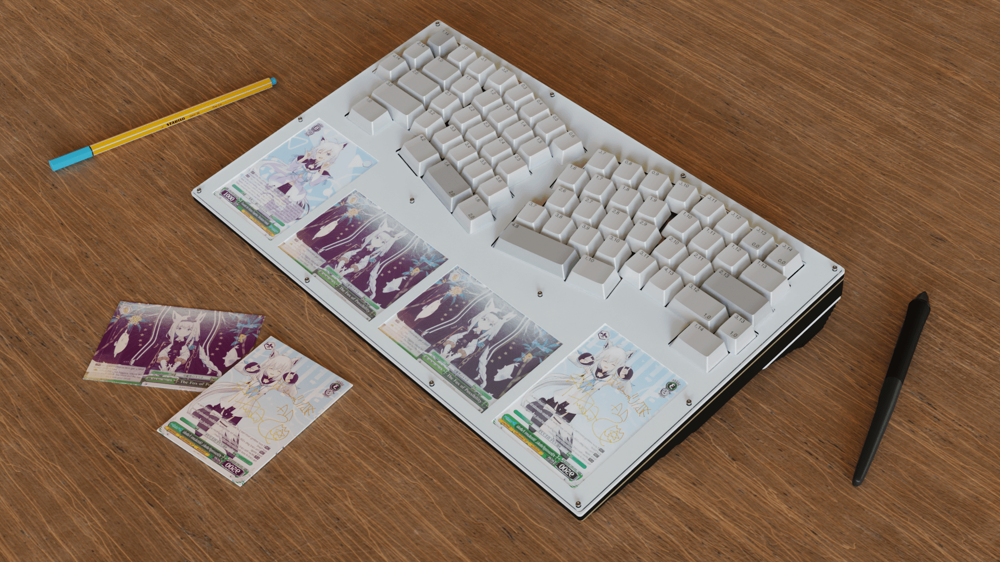
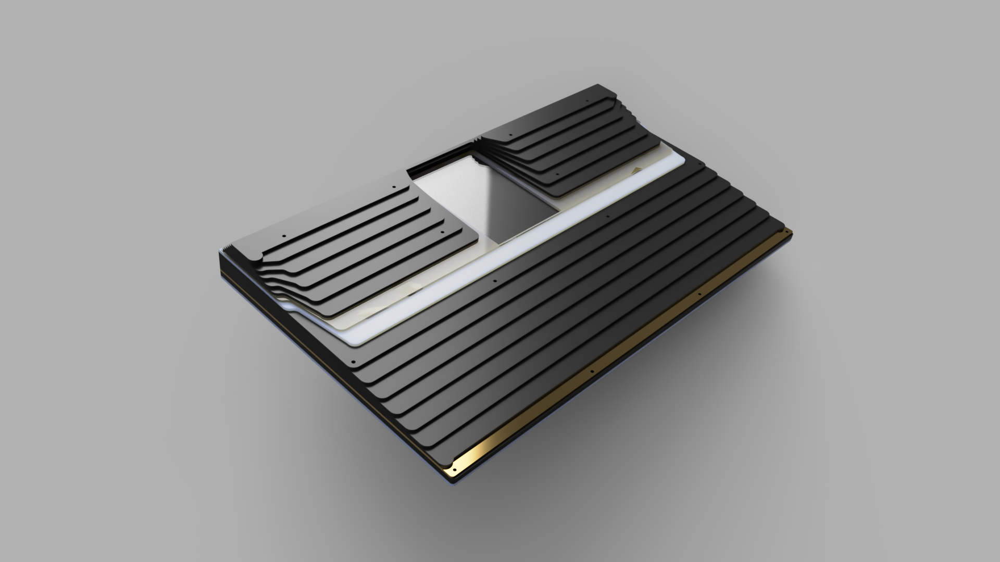
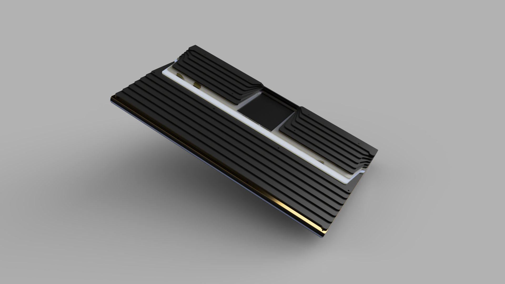
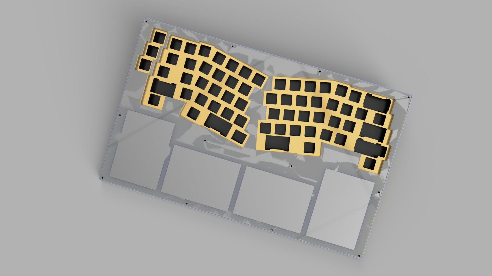
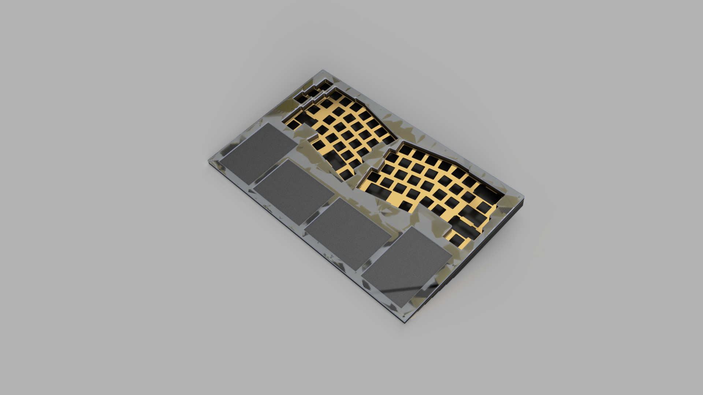
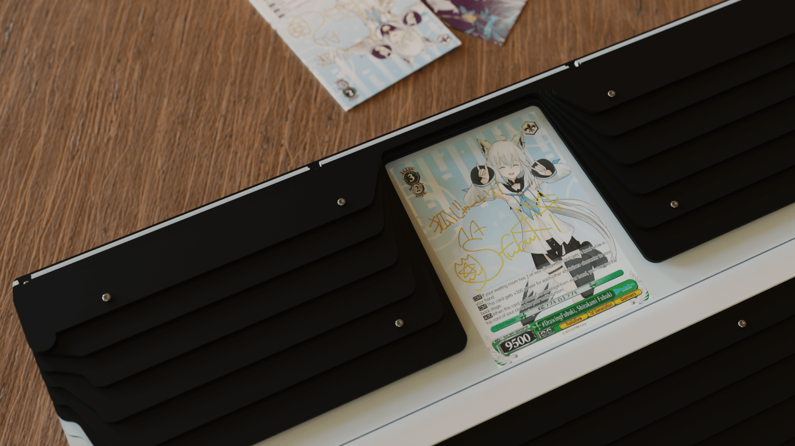
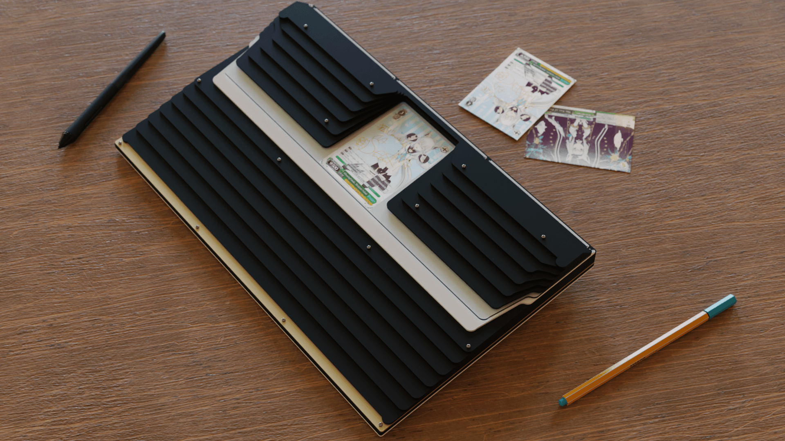
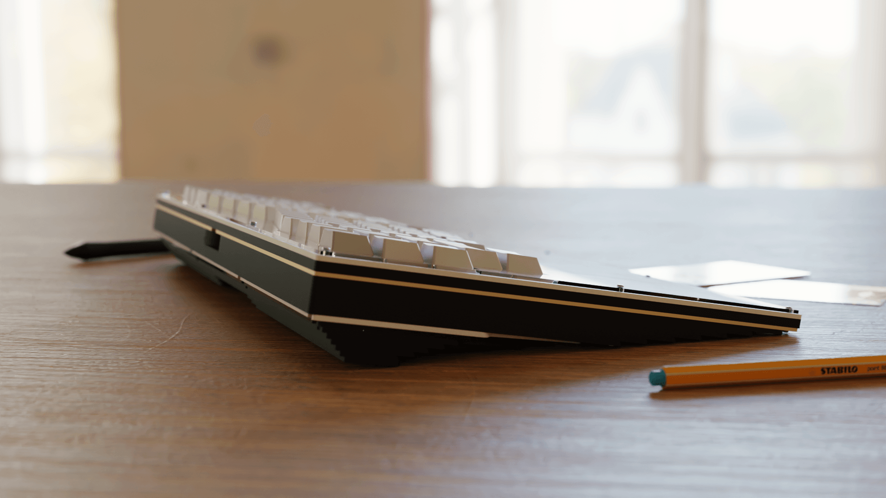
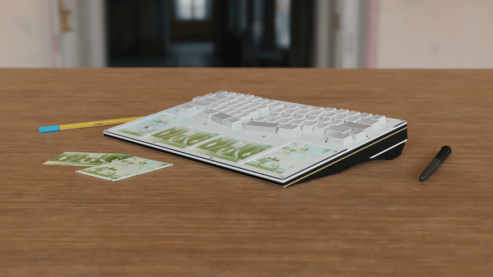
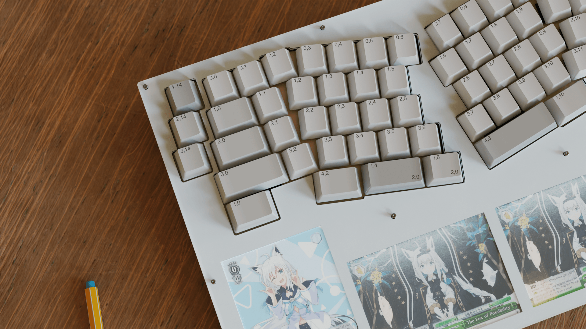

# 🃏 PHOTOLICE

> *"An Alice-layout (68-key) CNC aluminium keyboard concept with a fold-out TCG card holder —* ***photo + alice.***"

> **⚠️ Status: never produced.** Photolice was designed, modeled, and rendered, but was never manufactured. The board that was actually produced from this concept is **[Photolice Base](https://github.com/ReinTanto/photolice-base)**.

<p align="center">
  
</p>

---

## ⚙️ Specs

| | |
|---|---|
| **Form factor** | Alice layout (68-key, staggered) |
| **Type** | Concept — designed & rendered, never produced |
| **Case** | CNC-machined 6061 aluminium, anodized |
| **Colorway** | White top / black finned bottom, gold trim |
| **Signature feature** | Fold-out TCG card holder — the case doubles as a card display |
| **Bottom** | Ribbed / finned aluminium with a gold accent edge |
| **Sound profile** | Aluminium case — clean, muted (planned) |
| **Status** | Never produced — remains a concept. The produced board based on this concept is **Photolice Base** |

---

## 🔧 Development

- **CAD / modeling:** 2D DXF curve drafting (case, plate, card slots)
- **Renders:** Blender

---

## 🃏 The Design

Photolice is a **photo + alice** — an Alice-layout keyboard whose case doubles as a **TCG card holder**. The bottom of the case is a ribbed, finned aluminium slab; the top folds out to reveal a row of slots where trading cards sit on display, so the board is a keyboard *and* a card stand in one piece.

The design was drafted as 2D curve files (DXF) and modeled in 3D, then rendered in Blender. The white top plate carries the staggered Alice key layout and the card slots, while the black finned bottom — edged in gold — is what the board rests on when the card holder is folded away.

### 🏗️ Design & CAD views

<p align="center">
  
</p>

<details>
<summary>Bottom — finned slab</summary>
<p align="center"></p>
</details>

<details>
<summary>Plate — top view (Alice layout + card slots)</summary>
<p align="center"></p>
</details>

<details>
<summary>Plate — 3D model</summary>
<p align="center"></p>
</details>

---

## 🔨 The Build

- **2022** — the case, plate, and card-slot geometry were drafted as 2D curve files (DXF) and modeled in 3D.
- **2022** — the board was rendered in Blender (the "Color Corrected" render set is used for the gallery below).
- **Never produced** — the concept was designed and rendered but never manufactured. The board that was actually produced from this concept is **[Photolice Base](https://github.com/ReinTanto/photolice-base)**.

---

## 📷 The Result

<p align="center">
  
</p>

<details>
<summary>Bottom — finned slab on the desk</summary>
<p align="center"></p>
</details>

<details>
<summary>Side profile — gold accent edge</summary>
<p align="center"></p>
</details>

<details>
<summary>Top view — Alice layout with cards in the slots</summary>
<p align="center"></p>
</details>

<details>
<summary>Close-up — keycap labels + card slots</summary>
<p align="center"></p>
</details>

---

## 📁 Repository Structure

```
photolice/
├── README.md
├── images/
│   ├── design/
│   │   ├── 01-assembly-exploded.png   # Assembly / exploded view
│   │   ├── 02-bottom-fins.png         # Bottom — finned slab (CAD)
│   │   ├── 03-plate-top.png           # Plate — top view (Alice layout + card slots)
│   │   └── 04-plate-model.png         # Plate — 3D model
│   └── render/
│       ├── 01-card-closeup.png        # A TCG card in a fold-out slot
│       ├── 02-desk-angle.png          # Hero — assembled board on the desk
│       ├── 03-bottom-fins.png         # Bottom — finned slab on the desk
│       ├── 04-side-profile.png        # Side profile — gold accent edge
│       ├── 05-top-cards.png           # Top view — Alice layout with cards
│       └── 06-keycap-labels.png       # Close-up — keycap labels + card slots
└── sources/
    ├── photolice.dxf                 # Case / plate curve draft
    └── photolice-smoll-2022.dxf      # Card-slot curve draft
```

---

*Designed by [ReinTanto](https://github.com/ReinTanto). A concept — never produced. The produced board based on this concept is [Photolice Base](https://github.com/ReinTanto/photolice-base).* 🃏
